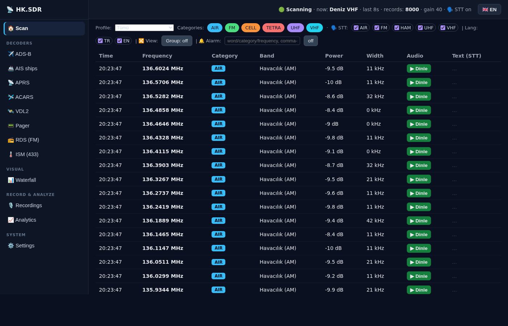
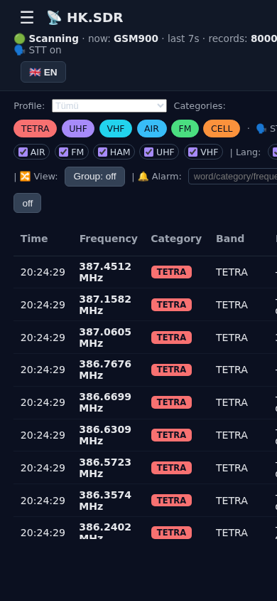
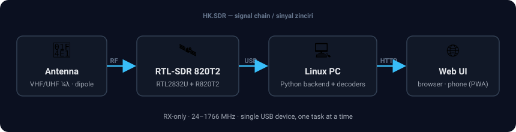

<div align="center">

# 📡 HK.SDR

### A browser-based, multi-mode RTL-SDR scanner, decoder & signal-analysis lab

**English** · [Türkçe](README.tr.md)

[](LICENSE)
[](COMMERCIAL_LICENSE.md)
[](https://github.com/sponsors/haliskilic)
[](https://www.python.org/)
[]()
[]()




</div>

## 🎯 Purpose

**HK.SDR** turns a cheap RTL-SDR 820T2 dongle into a continuously-scanning, multi-mode
**signal-analysis lab** you drive entirely from your browser. It was built as an educational,
**receive-only** project to *find, log, classify, decode and transcribe* the radio signals
around you — across aviation, maritime, paging, sensors, broadcast and digital bands — without
any cloud service. Everything runs locally on your machine.

The whole web backend is **pure Python standard library** (`http.server` + `sqlite3`, no pip
dependencies); only optional features (speech-to-text, modulation classification) use extra tools.

## ✨ Features

- **Continuous categorized scanning** — sweeps band plans with `rtl_power`, logs every signal
  (frequency, power, bandwidth, category, band) to SQLite with a live, newest-on-top history.
- **Live audio** — click any audio-capable channel to stream live WB-FM / AM / NFM, with an
  optional WebAudio **noise filter**; every listen is auto-archived as a WAV recording.
- **Decoders** (one shared dongle, mutually exclusive modes):
  - ✈️ **ADS-B** aircraft tracking on a live map (dump1090)
  - 🚢 **AIS** ship tracking (rtl_ais)
  - 📡 **APRS** stations (multimon-ng)
  - 🛩️ **ACARS** & 🛰️ **VDL2** aircraft data-link messages (acarsdec / dumpvdl2)
  - 📟 **Pager** POCSAG/FLEX — **content masked for privacy** (type + capcode + length only)
  - 📻 **RDS** FM station name / radiotext (redsea)
  - 🌡️ **ISM 433 MHz** sensors — grouped live device table (rtl_433): TPMS, thermometers, remotes…
- **Waterfall / spectrum** — live canvas heatmap; **click to listen**, **Shift-click to classify**,
  scroll to zoom.
- **Speech-to-text (STT)** — offline, on-device transcription with **whisper.cpp** (multilingual,
  auto TR/EN detection); optional Turkish-tuned `distil-whisper-large-v3-tr`. Activity-gated; shows
  one sentence per audio frequency in the scan table and a live flowing transcript while listening.
- **Modulation classification** — feature-based (bandwidth / envelope CV / spectral flatness / SNR)
  rule classifier (FM-wide, constant-envelope digital, AM/NFM, OOK, noise) + likely-service lookup.
- **Analytics & search** — most-active frequencies, category & hourly distribution, full-text search,
  CSV/JSON export.
- **Frequency grouping** — collapse repeated detections of the same frequency into one row with a
  count and last-seen.
- **Scan profiles & scheduling**, **gain / PPM calibration**, **CSV bookmark import**, **alarms**
  (browser notification + beep + toast on keyword/category/frequency match).
- **PWA** — installable on a phone; **bilingual UI (English / Türkçe)** with a one-click flag toggle;
  optional Basic-auth and LAN binding.

## 🖼️ Screenshots

| Desktop — scan view | Mobile (PWA) |
|---|---|
|  |  |

## 🔌 Hardware



| Item | Requirement |
|------|-------------|
| **SDR** | RTL-SDR dongle (RTL2832U + R820T2 / "820T2", USB id `0bda:2838`). RTL-SDR Blog **V4** recommended for stability (TCXO, better filtering). |
| **Antenna** | Band-appropriate antenna. ADS-B (1090 MHz) works with a short whip; **VHF/UHF (airband, AIS, APRS, ACARS/VDL2, ISM 433)** needs a proper ~½λ dipole or ~46 cm ¼λ. Reception — not code — is the main limitation on weak bands. |
| **Power/USB** | A **powered USB hub** is strongly recommended — the 820T2 can drop off the bus under sustained load (heat / marginal power). |
| **Host** | Any Linux PC / SBC (Raspberry Pi class and up). |

> 📷 *Tip: add your own photo of your setup at `docs/images/hardware.jpg` and reference it here.*

## 🧰 Software requirements

| Component | Needed for |
|-----------|-----------|
| **Linux** (Debian 12 tested) + **Python 3.11+** | core (web backend is stdlib-only) |
| **rtl-sdr** tools (`rtl_power`, `rtl_fm`, `rtl_sdr`, `rtl_test`) | scanning & live audio (**required**) |
| `numpy` | modulation classification |
| `rtl_433` | ISM 433 MHz sensors |
| `multimon-ng` | Pager (POCSAG/FLEX) & APRS |
| `dump1090` | ADS-B |
| `rtl_ais` | AIS |
| `acarsdec` / `dumpvdl2` | ACARS / VDL2 |
| `redsea` | RDS |
| **whisper.cpp** (+ model) · optional `faster-whisper` | speech-to-text |

## 📥 Installation

```bash
git clone https://github.com/haliskilic/hksdr.git
cd hksdr

# 1) Core: RTL-SDR drivers + common decoder tools (apt; needs sudo)
sudo bash setup/setup.sh

# 2) Optional decoders (build from source into ~/.local)
bash setup/build_dump1090.sh      # ADS-B
bash setup/build_rtl_ais.sh       # AIS
bash setup/build_acarsdec.sh      # ACARS
bash setup/build_dumpvdl2.sh      # VDL2
bash setup/build_redsea.sh        # RDS

# 3) Optional speech-to-text (whisper.cpp small, multilingual)
bash setup/setup_whisper.sh
# Optional Turkish-tuned model (heavier, opt-in via USE_DISTIL_TR=1):
bash setup/setup_distil_tr.sh
```

The web app itself has **no Python dependencies** — only the optional STT/classify features use
`numpy` / `faster-whisper`.

## 🚀 Usage

```bash
scripts/run_webapp.sh                 # → http://localhost:8000
# options:
PORT=9000 GAIN=45 scripts/run_webapp.sh
HOST=0.0.0.0 scripts/run_webapp.sh    # serve on the LAN (use AUTH for security)
AUTH=user:pass HOST=0.0.0.0 scripts/run_webapp.sh
USE_DISTIL_TR=1 scripts/run_webapp.sh # enable the Turkish distil-whisper engine
```

Open the page and **scanning starts automatically**. Use the left menu (☰) to open a decoder,
the map, the waterfall, recordings, analytics or settings. Click a frequency's **▶ Listen** to
hear it. Switch language any time with the **🇬🇧/🇹🇷** button (top-right).

## 🏗️ Architecture (short)

A single `Device` manager serializes the one RTL-SDR across mutually-exclusive modes
(`scan / listen / adsb / ais / aprs / ism / pager / acars / rds / vdl2 / wf`). The scanner runs
in a background thread; decoders are subprocess wrappers that parse tool output into SQLite /
in-memory state. The frontend is a dependency-light vanilla-JS SPA that polls JSON endpoints.
See [`docs/ROADMAP.md`](docs/ROADMAP.md) for the full design, status and roadmap.

## ⚖️ Legal & ethics

HK.SDR is **receive-only** and intended for **education and lawful monitoring of open signals**.
You are responsible for complying with the radio/privacy laws of your country.

- Pager content is **masked** (only type/capcode/length stored) — privacy by design.
- Decoding **encrypted / public-safety** voice (e.g. TETRA/P25/DMR) is **out of scope**.
- STT is meant for **legal, open analog and unencrypted-digital** signals only.

## 📄 License

HK.SDR is **dual-licensed**:

- **Open source — [GNU AGPL-3.0](LICENSE):** free to use, study, modify and share. If you distribute it, or run a modified version as a network service, you must make your complete source code available under the AGPL-3.0.
- **Commercial license:** for closed-source products, devices or SaaS without the AGPL-3.0 obligations — see [COMMERCIAL_LICENSE.md](COMMERCIAL_LICENSE.md) or email **mail@haliskilic.com.tr**.

Contributions are welcome! On your first pull request you'll be asked to sign a one-time [Contributor License Agreement](https://gist.github.com/haliskilic/7a7fdcd355f54d1db6943959d7b76823); you keep the copyright to your work.

Copyright © 2026 Halis KILIÇ.

## ❤️ Support the project

If HK.SDR is useful to you, please consider **[sponsoring my work on GitHub Sponsors ❤️](https://github.com/sponsors/haliskilic)** — sponsorships pay for test hardware and the time to keep the project maintained.

---

<div align="center">
Made for the RTL-SDR community · contributions welcome (see <a href="CONTRIBUTING.md">CONTRIBUTING</a>)
</div>
